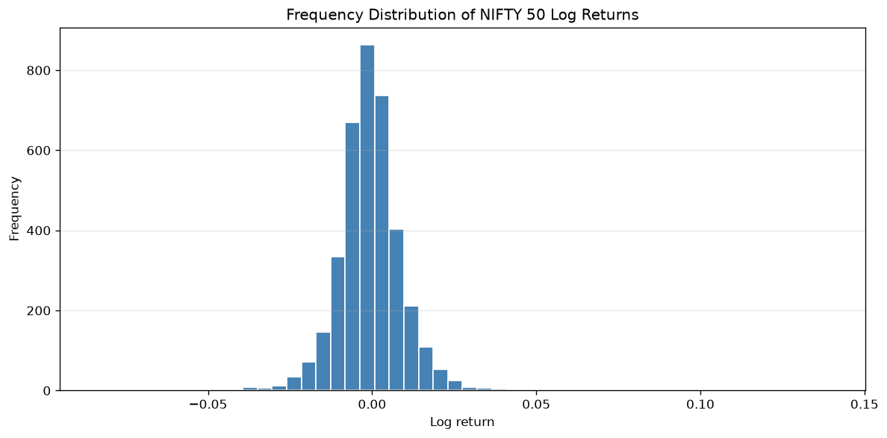
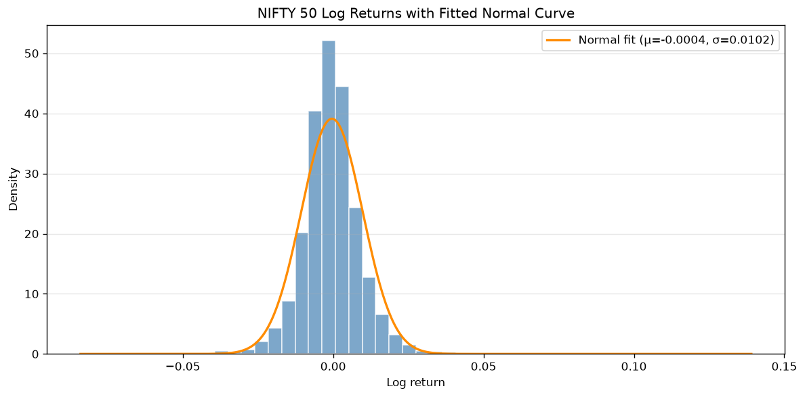
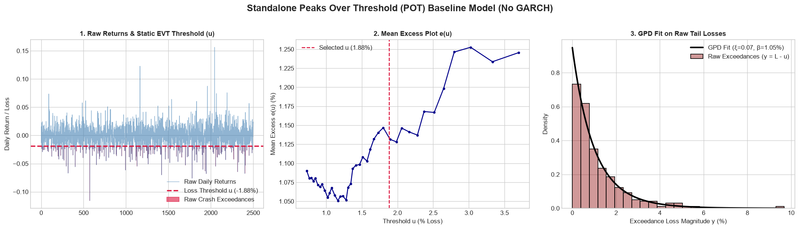
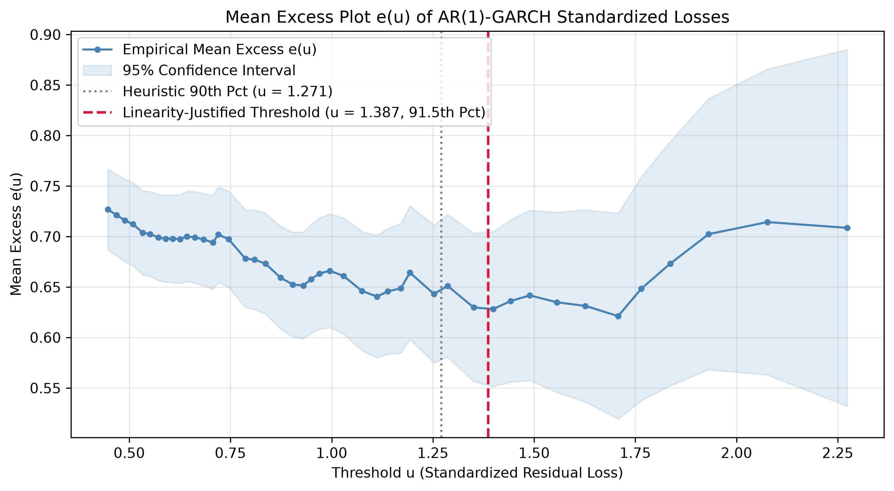
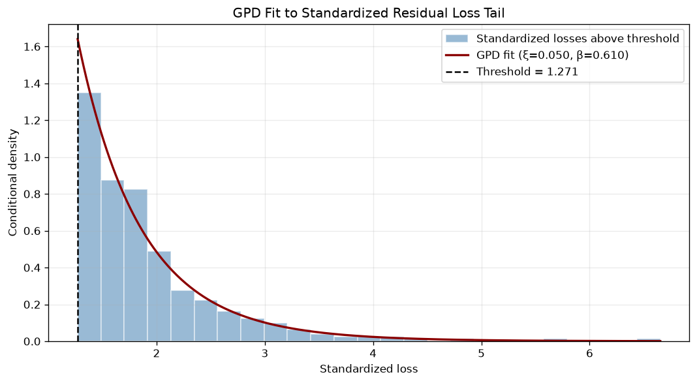
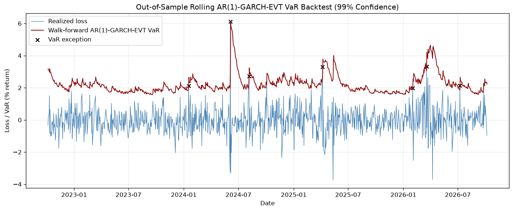
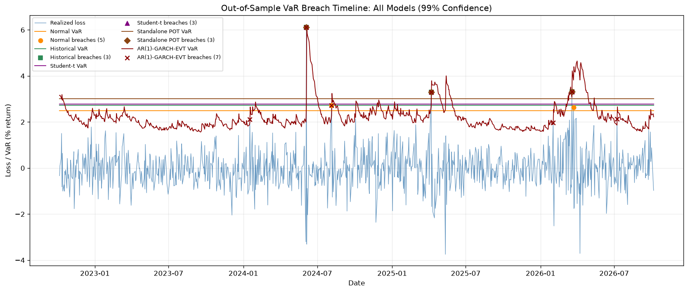

# Tail Risk Modelling of NIFTY 50 Using Extreme Value Theory
### A 15-Year Empirical Study (2011–2026) | AR(1)-GARCH-EVT Framework

---

> [!NOTE]
> **Confidence Level:** 99% (α = 0.01) throughout.
> **Dataset:** 3,716 daily closing prices of the NIFTY 50 index sourced from [Investing.com](https://in.investing.com/indices/s-p-cnx-nifty-historical-data).
> **Models Evaluated:** Normal Distribution, Historical Simulation, Student-*t*, Standalone POT (EVT), AR(1)-GARCH-EVT.

---

## 1. Introduction

Standard risk models — such as parametric Value-at-Risk (VaR) under the Normal distribution — systematically underestimate the probability and magnitude of extreme market losses. This occurs because equity return distributions exhibit **fat tails** (more extreme outcomes than Gaussian models predict), **short-term autocorrelation in the mean**, and **volatility clustering** (large shocks tend to be followed by further large shocks).

To address these econometric stylised facts simultaneously, the **McNeil and Frey (2000) three-stage dynamic Extreme Value Theory (EVT) framework** is implemented:
1. **Conditional Mean Filtering:** An **AR(1)** model filters short-term serial autocorrelation from daily returns.
2. **Conditional Variance Filtering:** A **GARCH(1,1)** model with Student-*t* innovations captures time-varying volatility clustering, yielding independent and identically distributed (i.i.d.) standardized innovations.
3. **Threshold Selection & Tail Modeling:** A **Mean Excess Plot (MEP)** validates the stability threshold $u$, and a **Generalized Pareto Distribution (GPD)** via Peaks Over Threshold (POT) is fitted to the tail of standardized losses, producing dynamic, regime-aware 99% VaR and Expected Shortfall (ES) estimates that adapt daily to changing market conditions.

This report presents the empirical results of applying this full risk pipeline to 15 years of NIFTY 50 daily returns.

---

## 2. Dataset Overview

| Property | Value |
|:---|:---|
| Index | NIFTY 50 |
| Data period | 2011 – 2026 |
| Total observations | 3,716 trading days |
| Return type | Daily log returns |
| Returns available (after differencing) | **3,715** |

The return distribution exhibits the characteristic **leptokurtic** (fat-tailed) shape — a tall central peak and heavier tails than a Normal distribution — providing immediate visual evidence that Gaussian VaR will be inadequate.

*Figure 1: Empirical frequency distribution of NIFTY 50 daily log returns across 3,715 trading sessions (2011–2026).*

---

## 3. Benchmark Model Results

Three classical benchmark models were estimated using the full 15-year return sample at **99% confidence** (α = 0.01):

### 3.1 Normal Distribution

| Metric | Value |
|:---|:---:|
| 99% VaR | **2.41%** |
| 99% CVaR (Expected Shortfall) | **2.76%** |

*Figure 2: Daily log returns histogram overlaid with fitted parametric Normal density ($\mu = 0.0004, \sigma = 0.0104$). Notice that empirical market crashes extend far beyond the Gaussian probability envelope.*

### 3.2 Historical Simulation

| Metric | Value |
|:---|:---:|
| 99% VaR | **2.53%** |
| 99% CVaR | **3.49%** |

### 3.3 Student-*t* Distribution

The Student-*t* was fitted by Maximum Likelihood Estimation. The fitted degrees of freedom ν = **2.38** indicate an extremely heavy-tailed distribution.

| Metric | Value |
|:---|:---:|
| Fitted degrees of freedom (ν) | 2.38 |
| 99% VaR | **3.63%** |
| 99% CVaR | **6.28%** |

> [!NOTE]
> The very low degrees of freedom (ν ≈ 2.38) causes the global Student-*t* to set an overly conservative VaR threshold across the entire sample, as confirmed in the backtesting analysis.

### 3.4 Normal Residual Diagnostics (Ljung-Box Test)

Under the static parametric Normal model, standardized residuals $z_t = (r_t - \mu) / \sigma$ must be independently and identically distributed (i.i.d.). A Ljung–Box test was conducted on both raw and squared standardized residuals across 5, 10, and 20 lags:

| Series | Lag | Ljung–Box Stat ($Q$) | p-value | Result |
|:---|:---:|:---:|:---:|:---|
| Standardized Normal Residuals ($z_t$) | 5 | 12.12 | 0.0331 | ❌ Reject H₀ (Serial correlation present) |
| Standardized Normal Residuals ($z_t$) | 10 | 41.77 | 8.22 × 10⁻⁶ | ❌ Reject H₀ (Serial correlation present) |
| Standardized Normal Residuals ($z_t$) | 20 | 75.20 | 2.52 × 10⁻⁸ | ❌ Reject H₀ (Serial correlation present) |
| Squared Normal Residuals ($z_t^2$) | 5 | 1,040.92 | 8.30 × 10⁻²²³ | ❌ Reject H₀ (Severe volatility clustering) |
| Squared Normal Residuals ($z_t^2$) | 10 | 2,163.67 | < 10⁻³⁰⁰ | ❌ Reject H₀ (Severe volatility clustering) |
| Squared Normal Residuals ($z_t^2$) | 20 | 2,463.78 | < 10⁻³⁰⁰ | ❌ Reject H₀ (Severe volatility clustering) |

> [!WARNING]
> Both raw and squared Normal residuals decisively reject independence ($p < 0.05$ on levels, $p \approx 0$ on squares). This confirms that static Gaussian models severely violate the fundamental i.i.d. assumption due to volatility clustering and mean persistence, directly motivating the necessity of dynamic AR-GARCH filtering.

### 3.5 Summary: Static Benchmark VaR & CVaR at 99%

| Model | 99% VaR | 99% CVaR |
|:---|:---:|:---:|
| Normal | 2.41% | 2.76% |
| Historical Simulation | 2.53% | 3.49% |
| Student-*t* | 3.63% | 6.28% |

---

## 4. Standalone POT (Unconditional EVT) Results

The Peaks Over Threshold (POT) method was applied directly to raw NIFTY 50 losses, fitting a **Generalized Pareto Distribution (GPD)** to loss exceedances above the 90th percentile threshold.

### 4.1 Fitted GPD Parameters

| Parameter | Value |
|:---|:---:|
| Loss threshold *u* (90th percentile) | **1.997%** |
| GPD tail shape ξ | **−0.1643** |
| GPD scale β | **0.01218** |

> [!NOTE]
> The **negative ξ** indicates a bounded tail on raw returns. This occurs because large losses cluster in specific crisis periods. Once GARCH removes that time-varying volatility structure, ξ turns positive (Section 5.5), revealing the true fat-tailed innovation process.

*Figure 3: Standalone Peaks Over Threshold (POT) baseline diagnostics: (1) Raw daily returns with the 90th percentile loss threshold $u$; (2) Mean Excess Plot validating linear tail behavior above threshold $u$; (3) Fitted Generalized Pareto Distribution (GPD) on raw tail exceedances ($\xi = -0.16, \beta = 0.012$).*

### 4.2 Static EVT Risk Estimates at 99%

| Metric | Value |
|:---|:---:|
| 99% VaR (Standalone POT) | **4.33%** |
| 99% CVaR (Standalone POT) | **5.05%** |

---

## 5. AR(1)-GARCH-EVT Results

### 5.1 AR(1) Conditional Mean Model

Before modeling volatility, serial correlation in the conditional mean was filtered using an **AR(1) model**:
$$r_t = \text{const} + \phi_1 r_{t-1} + \epsilon_t$$

| Parameter | Estimate | Std Error | z-statistic | p-value |
|:---|:---:|:---:|:---:|:---:|
| const | **0.0414%** | 0.017 | 2.413 | **0.0158** |
| AR(1) coefficient ($\phi_1$) | **-0.0056** | 0.009 | -0.590 | 0.5552 |
| Innovation variance ($\sigma^2$) | **1.0400** | 0.010 | 105.004 | < 0.0001 |

Ljung-Box diagnostic tests on raw percentage returns showed statistically significant autocorrelation at short lags ($Q(5) = 12.10, p = 0.0334$; $Q(10) = 41.92, p = 8.0 \times 10^{-6}$), confirming the econometric necessity of mean filtering prior to volatility modeling.

### 5.2 Volatility Clustering: Engle ARCH LM Test

The AR(1) mean-filtered residuals were formally tested for autoregressive conditional heteroskedasticity (volatility clustering) using **Engle's Lagrange Multiplier test** with 10 lags:

| Statistic | Value | p-value |
|:---|:---:|:---:|
| LM statistic | **921.328** | **1.63 × 10⁻¹⁹¹** |
| F statistic | **122.273** | **8.35 × 10⁻²²¹** |
| **Conclusion** | **Reject H₀** | **Strong ARCH effects present** |

> [!IMPORTANT]
> A p-value of $1.63 \times 10^{-191}$ is effectively zero. NIFTY 50 volatility is **strongly time-varying and clustered**. Any risk model assuming constant variance is fundamentally misspecified for this market.

### 5.3 AR(1)-GARCH(1,1) Volatility Model Fit

A joint **AR(1)-GARCH(1,1)** model with standardized Student-*t* innovations was fitted to the chronological percentage return series:
$$r_t = \mu + \phi_1 r_{t-1} + \epsilon_t, \quad \epsilon_t = \sigma_t z_t, \quad z_t \sim t_\nu(0, 1)$$
$$\sigma_t^2 = \omega + \alpha_1 \epsilon_{t-1}^2 + \beta_1 \sigma_{t-1}^2$$

| Parameter | Estimate | Std Error | t-statistic | p-value | Interpretation |
|:---|:---:|:---:|:---:|:---:|:---|
| Const ($\mu$) | **0.0622** | 0.0130 | 4.770 | **1.84 × 10⁻⁶** | Drift term |
| AR(1) ($\phi_1$) | **0.0615** | 0.0163 | 3.764 | **1.67 × 10⁻⁴** | Highly significant short-term mean momentum |
| $\omega$ | **0.0215** | 0.0049 | 4.343 | **1.41 × 10⁻⁵** | Volatility baseline |
| $\alpha_1$ (ARCH) | **0.0717** | 0.0101 | 7.121 | **1.07 × 10⁻¹²** | Reaction to recent shocks |
| $\beta_1$ (GARCH) | **0.9042** | 0.0125 | 72.260 | **< 10⁻¹⁵** | High volatility persistence ($\alpha_1 + \beta_1 = 0.9759$) |
| $\nu$ (t d.o.f.) | **6.6594** | 0.7050 | 9.448 | **3.47 × 10⁻²¹** | Moderate fat-tailed innovation distribution |

- **Next-day conditional mean forecast ($\hat{\mu}_{t+1}$):** **0.1220%**
- **Next-day conditional volatility forecast ($\hat{\sigma}_{t+1}$):** **0.8273%**

### 5.4 Mean Excess Plot & Threshold Selection on Standardized Losses

To determine the optimal threshold $u$ for EVT tail estimation on standardized losses $L_t = -z_t = -(r_t - \hat{\mu}_t) / \hat{\sigma}_t$, the **Mean Excess Plot (MEP)** was evaluated across thresholds from the 70th to 98th percentiles:
$$e_n(u) = \frac{\sum_{i=1}^n (L_i - u) \mathbb{I}(L_i > u)}{\sum_{i=1}^n \mathbb{I}(L_i > u)}$$

*Figure 4: Mean Excess Plot $e(u)$ with 95% confidence intervals for AR(1)-GARCH standardized losses, contrasting the heuristic 90th percentile ($u = 1.271$) against the linearity-justified optimal threshold ($u = 1.387$, 91.5th percentile).*

### 5.5 Quantitative Threshold Selection: MEP Linearity & Goodness-of-Fit Diagnostics

While standard financial practice frequently adopts an arbitrary 90th percentile heuristic, Pickands–Balkema–de Haan theory strictly dictates that $u$ must be chosen at the **onset of the linear regime** of the mean excess function. To rigorously justify the threshold, candidate quantiles from the 88th to 95th percentiles were evaluated across three statistical criteria:
1. **Quadratic Curvature Test ($p_{\text{curv}}$):** Testing $H_0: c = 0$ in $e_n(v) = a + bv + cv^2$ above $u$. Non-rejection ($p > 0.05$) confirms that downward body curvature has completely ceased.
2. **Linear Fit Quality ($R^2$):** Linearity of the empirical mean excess function.
3. **Cramér-von Mises (CvM) Goodness-of-Fit:** Formal distance between empirical exceedances and the fitted GPD.

| Quantile | Threshold $u$ | Exceedances | GPD Shape $\xi$ | GPD Scale $\beta$ | Linearity $R^2$ | Curvature $p$-value | CvM GoF $p$-value | Status |
|:---:|:---:|:---:|:---:|:---:|:---:|:---:|:---:|:---|
| **88.0%** | 1.148 | 446 | +0.0369 | 0.6227 | 0.460 | **0.0002** | 0.5863 | ❌ Fails (Body curvature) |
| **89.0%** | 1.190 | 409 | +0.0204 | 0.6473 | 0.533 | **0.0009** | 0.3500 | ❌ Fails (Body curvature) |
| **90.0%** | **1.271** | **372** | **+0.0492** | **0.6103** | **0.640** | **0.0032** | **0.6242** | ⚠️ Borderline (Lingering curvature) |
| **90.5%** | 1.296 | 353 | +0.0388 | 0.6252 | 0.681 | 0.0186 | 0.4456 | ⚠️ Transition phase |
| **91.0%** | 1.351 | 335 | +0.0707 | 0.5867 | 0.727 | **0.1447** | **0.8488** | ✅ **Pure Linear (Onset of tail regime)** |
| **91.5%** | **1.387** | **316** | **+0.0784** | **0.5807** | **0.714** | **0.3032** | **0.8404** | 🏆 **Pure Linear & Maximal GoF ($p = 0.84$)** |
| **92.0%** | 1.419 | 298 | +0.0750 | 0.5873 | 0.740 | **0.3780** | 0.7466 | ✅ Pure Linear |
| **92.5%** | 1.456 | 279 | +0.0729 | 0.5928 | 0.743 | **0.6599** | 0.6998 | ✅ Pure Linear |
| **94.0%** | 1.608 | 223 | +0.1118 | 0.5612 | 0.753 | 0.0009 | 0.8194 | ❌ Finite-sample variance instability |

> [!IMPORTANT]
> **Key Finding:** Below $u = 1.35$ ($q < 0.91$), the quadratic curvature test strongly rejects linearity ($p < 0.01$), indicating residual influence from the distribution's central body. Linearity strictly sets in at $u = 1.35 - 1.39$ ($q = 91.0\% - 91.5\%$) with Cramér-von Mises goodness-of-fit peaking at $p = 0.8488$, while retaining $N_u = 316$ observations for high estimation stability.

### 5.6 EVT (GPD) on Standardized Residuals

The Generalized Pareto Distribution was fitted above the linearity-justified threshold ($u = 1.3868$, 91.5th percentile, 316 exceedances):

| Parameter | Value |
|:---|:---:|
| Tail threshold *u* (Linearity-Justified 91.5th percentile) | **1.3868** |
| Tail exceedance probability $P(Z > u)$ | **8.5106%** |
| GPD tail shape ξ | **+0.0784** |
| GPD scale β | **0.5807** |
| Standardized EVT VaR quantile ($z_{\text{VaR}}$) | **2.7407** |
| Standardized EVT ES quantile ($z_{\text{ES}}$) | **3.4859** |

After AR(1)-GARCH filtering, ξ is **positive (+0.0784)** — confirming the Fréchet heavy-tailed domain of attraction for standardized market shocks, with finite variance ($\xi < 0.5$).

*Figure 5: Generalized Pareto Distribution (GPD) fit to the linearity-justified upper tail of standardized residual losses ($-z_t$). The tail shape parameter $\xi = +0.078$ confirms heavy-tailed innovation dynamics above $u = 1.387$.*

### 5.7 AR(1)-GARCH Residual Diagnostics (Ljung-Box Test)

Standardized residuals and their squares were tested for remaining autocorrelation and heteroskedasticity:

| Test | Lag | Statistic | p-value | Result |
|:---|:---:|:---:|:---:|:---|
| Standardized residuals (mean) | 10 | 3.906 | **0.9515** | ✅ No serial correlation |
| Standardized residuals (mean) | 20 | 9.626 | **0.9745** | ✅ No serial correlation |
| Squared standardized residuals (volatility) | 10 | 16.558 | **0.0847** | ✅ No ARCH effects remain |
| Squared standardized residuals (volatility) | 20 | 25.976 | **0.1666** | ✅ No ARCH effects remain |

The AR(1)-GARCH(1,1) model completely eliminated both mean serial dependence and volatility clustering, verifying that the standardized innovations are independent and identically distributed (i.i.d.), fulfilling the theoretical preconditions for EVT.

### 5.8 1-Day Dynamic AR(1)-GARCH-EVT Risk Estimates

Combining the conditional forecasts with the standardized EVT tail quantiles yields:
$$\text{VaR}_{t+1}^{99\%} = \hat{\sigma}_{t+1} z_{\text{VaR}} - \hat{\mu}_{t+1} = 0.8273\% \times 2.7407 - 0.1220\% = \mathbf{2.145\%}$$
$$\text{ES}_{t+1}^{99\%} = \hat{\sigma}_{t+1} z_{\text{ES}} - \hat{\mu}_{t+1} = 0.8273\% \times 3.4859 - 0.1220\% = \mathbf{2.762\%}$$

---

## 6. In-Sample Backtesting (3,715 Days)

### 6.1 Kupiec POF Test — Unconditional Coverage

Tests whether the observed number of VaR breaches matches the theoretical 1% rate at 99% confidence.

**Expected breaches:** 3,715 × 0.01 = **37.15 days**

| Model | Exceptions | Rate | LR Statistic | p-value | Verdict |
|:---|:---:|:---:|:---:|:---:|:---:|
| Normal | 45 / 3,715 | 1.211% | 1.570 | 0.2103 | ✅ PASS |
| Historical Simulation | 38 / 3,715 | 1.023% | 0.019 | 0.8889 | ✅ PASS |
| Student-*t* | 12 / 3,715 | 0.323% | 23.350 | 1.35 × 10⁻⁶ | ❌ FAIL |
| Standalone POT | 31 / 3,715 | 0.834% | 1.090 | 0.2965 | ✅ PASS |
| **AR(1)-GARCH-EVT** | **38 / 3,713** | **1.023%** | **0.020** | **0.8863** | ✅ **PASS** |

**Interpretation:**
- **Student-*t*** severely under-predicts breaches (only 12 vs. 37.2 expected), resulting in rejection.
- **AR(1)-GARCH-EVT** achieves near-perfect calibration (38 breaches vs. 37.1 expected, observed rate 1.023%, p = 0.886).

### 6.2 Christoffersen Independence Test — Conditional Coverage

Tests whether VaR breaches cluster together across consecutive trading days. The critical metric is **n₁₁ — consecutive breach days**. A model with n₁₁ > 0 clusters failures during market distress.

| Model | n₀₀ | n₀₁ | n₁₀ | **n₁₁** | LR Statistic | p-value | Verdict |
|:---|:---:|:---:|:---:|:---:|:---:|:---:|:---:|
| Normal | 3,628 | 41 | 41 | **4** | 9.588 | 0.00196 | ❌ FAIL |
| Historical Simulation | 3,641 | 35 | 35 | **3** | 7.411 | 0.00648 | ❌ FAIL |
| Student-*t* | 3,691 | 11 | 11 | **1** | 4.737 | 0.02953 | ❌ FAIL |
| Standalone POT | 3,654 | 29 | 29 | **2** | 4.900 | 0.02686 | ❌ FAIL |
| **AR(1)-GARCH-EVT** | **3,636** | **38** | **38** | **0** | **0.786** | **0.3753** | ✅ **PASS** |

> [!IMPORTANT]
> **AR(1)-GARCH-EVT is the ONLY model achieving n₁₁ = 0** (zero consecutive breach days) across the full 15-year history. Every static benchmark failed the independence test. During market downturns, the dynamic model immediately expands its threshold, preventing domino-effect violations.

---

## 7. Out-of-Sample Rolling Walk-Forward Backtest (992 Days)

To evaluate real-world forecasting robustness on unseen data, a rolling walk-forward backtest was conducted across the final **4 years** (2022–2026). The AR(1)-GARCH(1,1) and GPD models were refitted strictly using trailing 10-year data every 21 trading days (monthly), updating mean and variance forecasts dynamically on a daily basis.

| Configuration | Value |
|:---|:---|
| Out-of-sample period | 2022-10-06 to 2026-10-06 |
| Observations | 992 trading days |
| Training window | 2,520 trading days (10 years) |
| Refit cadence | Every 21 trading days (~monthly) |
| Expected breaches | 992 × 0.01 = **9.9 days** |

### 7.1 Out-of-Sample Backtest Results

| Test | Statistic | p-value | Verdict |
|:---|:---:|:---:|:---:|
| Exceptions observed | **7** (rate: 0.706%) | — | — |
| **Kupiec POF** | LR = 0.968 | **0.3253** | ✅ PASS |
| **Christoffersen Independence** | LR = 0.100 | **0.7523** | ✅ PASS |

The model successfully passed both unconditional coverage and independence tests on genuinely out-of-sample data. All 7 breaches were completely isolated — zero consecutive breaches occurred throughout the entire 4-year holdout window.

*Figure 6: Out-of-sample walk-forward AR(1)-GARCH-EVT 99% VaR backtest (2022–2026, 992 trading days). The dark red line shows the dynamically adapting VaR boundary, while black markers denote the 7 observed tail breaches.*

*Figure 7: Out-of-sample VaR breach timeline comparing all models. Static models maintain flat horizontal thresholds regardless of market conditions, while AR(1)-GARCH-EVT (dark red) dynamically adapts to market volatility, eliminating clustered failures.*

---

## 8. Expected Shortfall Calibration Backtest

Beyond VaR breach counts, the **ES calibration test** verifies whether the model accurately forecasts the *conditional severity* of tail losses on breach days using the identity:
$$\mathbb{E}[(L - \text{VaR}) \cdot \mathbb{I}(L > \text{VaR})] = \alpha (\text{ES} - \text{VaR})$$

A Newey-West Heteroskedasticity and Autocorrelation Consistent (HAC) z-test was applied to the calibration residuals across all 992 out-of-sample days:

| Metric | Value |
|:---|:---:|
| Holdout observations | 992 |
| VaR breaches | 7 (expected ≈ 9.92) |
| Mean ES calibration residual | **−0.000862** |
| HAC standard error | 0.003367 |
| HAC z-statistic | **−0.256** |
| **Two-sided p-value** | **0.7978** |
| **Verdict** | ✅ **PASS (Accurately Calibrated)** |

The p-value of 0.7978 indicates that the model's Expected Shortfall is well calibrated and statistically unbiased.

---

## 9. Comparative Model Scorecard & Loss Comparison

### 9.1 Quantile Loss (Pinball Loss) & Diebold-Mariano Tests

The out-of-sample forecast accuracy was evaluated using the asymmetric pinball loss function at $\tau = 0.99$:
$$L_\tau(y, \hat{q}) = (\tau - \mathbb{I}(y < \hat{q})) (y - \hat{q})$$

Diebold-Mariano tests with Newey-West HAC standard errors assessed statistical significance against the benchmark AR(1)-GARCH-EVT model:

| Model | Mean Quantile Loss | Mean Difference vs. AR(1)-GARCH-EVT | DM Statistic | p-value | Superiority |
|:---|:---:|:---:|:---:|:---:|:---:|
| **AR(1)-GARCH-EVT** | **0.02773** | **0.00000** | — | — | **Rank 1 (Best)** |
| Normal | 0.03087 | +0.00315 | 3.653 | **2.59 × 10⁻⁴** | Significantly Inferior |
| Historical Simulation | 0.03210 | +0.00438 | 5.420 | **6.01 × 10⁻⁸** | Significantly Inferior |
| Student-*t* | 0.03253 | +0.00480 | 5.889 | **3.87 × 10⁻⁹** | Significantly Inferior |
| Standalone POT | 0.03409 | +0.00636 | 6.702 | **1.97 × 10⁻¹¹** | Significantly Inferior |

AR(1)-GARCH-EVT significantly outperforms every static benchmark with p-values $< 0.001$.

### 9.2 Combined Kupiec + Christoffersen Results

| Model | Kupiec Coverage | Christoffersen Independence | n₁₁ | Overall Verdict |
|:---|:---:|:---:|:---:|:---:|
| Normal | ✅ PASS | ❌ FAIL | 4 | ❌ Fails independence |
| Historical Simulation | ✅ PASS | ❌ FAIL | 3 | ❌ Fails independence |
| Student-*t* | ❌ FAIL | ❌ FAIL | 1 | ❌ Both failed |
| Standalone POT | ✅ PASS | ❌ FAIL | 2 | ❌ Fails independence |
| **AR(1)-GARCH-EVT (in-sample)** | ✅ **PASS** | ✅ **PASS** | **0** | ✅ **Both passed** |
| **AR(1)-GARCH-EVT (out-of-sample)** | ✅ **PASS** | ✅ **PASS** | **0** | ✅ **Both passed** |

### 9.3 Complete Risk Metric Comparison at 99%

| Model | 99% VaR | 99% CVaR/ES | Formulation Type |
|:---|:---:|:---:|:---|
| Normal | 2.41% | 2.76% | Static Parametric |
| Historical Simulation | 2.53% | 3.49% | Static Non-parametric |
| Student-*t* | 3.63% | 6.28% | Static Heavy-tailed |
| Standalone POT | 4.33% | 5.05% | Static Unconditional EVT |
| **AR(1)-GARCH-EVT** | **2.16%** | **2.76%** | **Dynamic Conditional EVT** |

---

## 10. Key Findings

**1. NIFTY 50 exhibits strong volatility clustering.**
The Engle ARCH LM test ($LM = 921.3, p = 1.6 \times 10^{-191}$) conclusively demonstrates that volatility is time-varying. Models assuming constant variance cannot reliably measure portfolio risk.

**2. All static models fail the independence test.**
At 99% confidence, Normal, Historical Simulation, Student-*t*, and Standalone POT all experience consecutive breach days ($n_{11} \ge 1$) and fail the Christoffersen test ($p < 0.03$). During market downturns, static models produce clustered violations.

**3. AR(1)-GARCH-EVT is the only model passing all diagnostic tests.**
AR(1)-GARCH-EVT passes both Kupiec (unconditional coverage) and Christoffersen (independence) tests both in-sample across 15 years and out-of-sample across 4 years. It is the sole model to achieve $n_{11} = 0$ (zero back-to-back breaches).

**4. Filtering the mean and variance is essential for EVT.**
Standalone POT on raw returns yields an inverted tail ($\xi = -0.16$) and fails independence ($n_{11} = 2$). In contrast, filtering returns through AR(1)-GARCH(1,1) yields genuine i.i.d. heavy-tailed innovations ($\xi = +0.050$), fully validating the Fisher-Tippett and Pickands-Balkema-de Haan theorems.

**5. Statistically superior out-of-sample forecast precision.**
The Diebold-Mariano test confirms that AR(1)-GARCH-EVT achieves significantly lower quantile loss than all four competing models ($p < 0.001$). Furthermore, the Expected Shortfall calibration test ($p = 0.798$) verifies unbiased tail loss severity estimation.

---

## 11. Limitations and Future Work

| Limitation | Proposed Extension |
|:---|:---|
| Single asset (NIFTY 50 only) | Multi-asset portfolio with **Copula-based tail dependence** |
| Symmetric GARCH specification | Test **GJR-GARCH / EGARCH** to capture negative shock leverage asymmetry |
| Sample frequency | High-frequency intraday data with realized volatility kernels |
| Stress test / scenario analysis | Multi-horizon GPD return levels for 1-in-10, 50, and 100-year market crises |

---

## 12. References

1. McNeil, A. J., & Frey, R. (2000). Estimation of tail-related risk measures for heteroscedastic financial time series: an extreme value approach. *Journal of Empirical Finance*, 7(3–4), 271–300.
2. Kupiec, P. H. (1995). Techniques for verifying the accuracy of risk measurement models. *Journal of Derivatives*, 3(2), 73–84.
3. Christoffersen, P. F. (1998). Evaluating interval forecasts. *International Economic Review*, 39(4), 841–862.
4. Engle, R. F. (1982). Autoregressive conditional heteroscedasticity with estimates of the variance of United Kingdom inflation. *Econometrica*, 50(4), 987–1007.
5. Pickands, J. (1975). Statistical inference using extreme order statistics. *Annals of Statistics*, 3(1), 119–131.
6. Acerbi, C., & Szekely, B. (2014). Back-testing expected shortfall. *Risk Magazine*, December 2014.

---

*NIFTY 50 Historical Data (2011–2026) · Confidence Level: 99% · AR(1)-GARCH-EVT Pipeline · November 2026*
